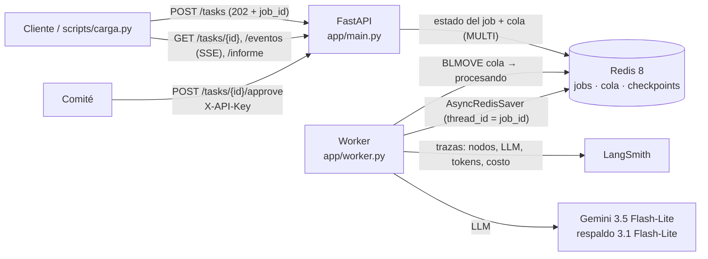
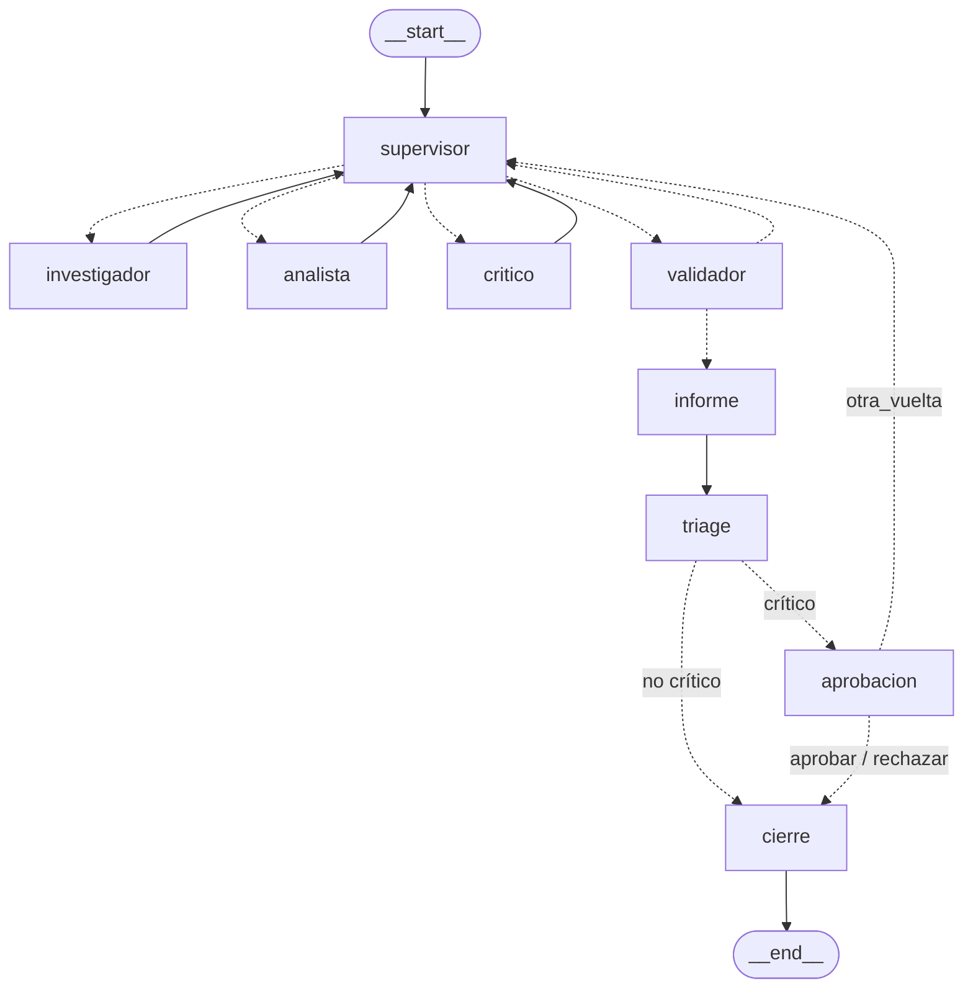

# API de producción para due diligence multi-agente de startups de IA

Pre-entrega 7 de AI Engineering (Coderhouse). El orquestador multi-agente de la [PE6](https://github.com/ivangonzalezseguezzo/aiengineering6-orquestador-due-diligence) (supervisor + investigador + analista + crítico) pasa a producción:

- **API REST asíncrona (FastAPI).** `POST /tasks` registra el análisis, lo encola y devuelve un `job_id` en milisegundos. La API nunca corre el grafo.
- **Worker en segundo plano.** Toma la cola de Redis, ejecuta el grafo y actualiza el estado del job en cada transición. Cualquier excepción termina en `failed`.
- **Redis** guarda el estado de los jobs, la cola y los **checkpoints de LangGraph** (`AsyncRedisSaver`). Un análisis sobrevive al reinicio del worker y de la API.
- **Observabilidad con LangSmith.** Cada ejecución es una traza con todos los nodos, las llamadas al LLM, los tokens, el costo y la latencia.
- **Human-in-the-loop selectivo.** Un nodo de triage decide si la recomendación es crítica. Las que comprometen capital o son ambiguas se detienen con `interrupt()` hasta que el comité decide con `POST /tasks/{id}/approve`. El descarte claro se emite solo.

Dominio: un fondo de inversión analiza startups de IA a partir de su *data room*. Todo es ficticio: 5 startups con perfiles distintos, informes de mercado y la tesis del fondo.

| Startup | Sector | Qué tiene que encontrar el sistema |
|---|---|---|
| VozActiva | Agentes de voz | MRR inflado con pilotos, margen sin voz y telefonía, runway con un préstamo sin firmar. Debería dar un descarte claro |
| Contralia | Legaltech | Una startup sana. Debería recomendar avanzar a comité |
| Aula Viva | Edtech | Datos insuficientes: tiene que abstenerse |
| Anamnesis *(nueva)* | Salud digital | Métricas medianas: "profundizar" |
| Lupa Code *(nueva)* | Herramientas para desarrolladores | Métricas excelentes, pero el margen declarado oculta créditos promocionales del LLM que vencen |

**Contenido:**
[Evidencia para la corrección](#evidencia-para-la-corrección) ·
[Arquitectura](#arquitectura) ·
[Instalación](#instalación-paso-a-paso) ·
[Uso de la API](#uso-de-la-api) ·
[Decisiones de diseño](#decisiones-de-diseño) ·
[Human-in-the-loop](#human-in-the-loop-selectivo) ·
[Prueba de carga](#prueba-de-carga) ·
[Lectura del dashboard](#lectura-del-dashboard) ·
[Prueba de persistencia](#prueba-de-persistencia-el-estado-sobrevive-a-la-caída-del-worker) ·
[Demo](#corrida-de-ejemplo-demoipynb) ·
[Índice de la evidencia](#índice-de-la-evidencia) ·
[Errores](#errores-y-cómo-reaccionar) ·
[Modelos](#modelos-por-defecto-ids-reales-de-cada-api) ·
[Tests](#tests) ·
[Limitaciones](#limitaciones-conocidas)

## Evidencia para la corrección

Cada criterio de la rúbrica, dónde está implementado y cómo verificarlo.

| Criterio (peso) | Implementación | Evidencia verificable |
|---|---|---|
| **Orquestación asíncrona y API (30 %)** | [app/main.py](app/main.py): endpoints `async` que solo usan `redis.asyncio`. [app/worker.py](app/worker.py): proceso aparte que corre el grafo | [tests/test_api.py](tests/test_api.py); latencia de `POST /tasks` en [evidencia/](evidencia/) (prueba de carga); [demo.ipynb](demo.ipynb) |
| **Persistencia con Redis (25 %)** | [app/graph.py](app/graph.py): `AsyncRedisSaver`, `thread_id = job_id`. [app/jobs.py](app/jobs.py): hash por job, cola confiable y transiciones atómicas | [Prueba de reinicio](#prueba-de-persistencia-el-estado-sobrevive-a-la-caída-del-worker) con sus logs en [evidencia/](evidencia/); [tests/test_worker.py](tests/test_worker.py), incluido un worker que se corta a mitad del análisis |
| **Observabilidad y trazado (25 %)** | [app/observability.py](app/observability.py): LangSmith y raíz `@traceable` por ejecución. [due_diligence/costos.py](due_diligence/costos.py): costo propio | Capturas en [screenshots/](screenshots/) (trazas, costo por ejecución, p95); [lectura del dashboard](#lectura-del-dashboard) |
| **Human-in-the-loop (15 %)** | [app/hitl.py](app/hitl.py): triage por criticidad, `interrupt()`, otra vuelta y cierre | [tests/test_hitl.py](tests/test_hitl.py); [demo.ipynb](demo.ipynb) con pausa, otra vuelta y aprobación; en la carga, 3 de 5 análisis pausaron y 2 se emitieron solos; capturas de threads y de un job en `awaiting_approval` |
| **Documentación y estructura (5 %)** | Este README, `requirements.txt`, `docker-compose.yml` y `.env.example` | [Instalación paso a paso](#instalación-paso-a-paso) y prueba de 5 peticiones en [scripts/carga.py](scripts/carga.py) |

Además: 163 tests offline. Su salida está en [evidencia/tests.txt](evidencia/tests.txt), por si el entorno del corrector no puede correrlos.

## Arquitectura



El grafo es el de la PE6 con tres nodos nuevos: `triage`, `aprobacion` y `cierre`. El diagrama sale de `grafo.get_graph().draw_mermaid()` ([docs/grafo.mmd](docs/grafo.mmd)):



## Instalación paso a paso

Hace falta **Python 3.12 o superior** y **Redis 8 o Redis Stack**. El checkpointer de LangGraph crea índices con Redis Query Engine y guarda JSON, así que un Redis común sin módulos no alcanza. Si el Redis no sirve, el worker lo avisa con un mensaje claro.

### Opción A: Docker Compose (API + worker + Redis 8)

```bash
cp .env.example .env        # completar GEMINI_API_KEY y LANGSMITH_API_KEY
docker compose up --build
# API y documentación interactiva: http://localhost:8000/docs
```

### Opción B: local con un entorno virtual y Redis Cloud

Es la opción que se usa para las corridas reales de la entrega.

1. **Redis.** Creá una base gratuita en [Redis Cloud](https://redis.io/try-free/); las bases nuevas traen Search y JSON. También sirve un Redis 8 local.
2. **Entorno virtual.** Instalá las dependencias dentro de un `venv`, no en el Python global. Algunos entornos bloquean el `pip install` global.

   ```bash
   python -m venv .venv
   # Windows (PowerShell):  .venv\Scripts\Activate.ps1
   # Windows (cmd):         .venv\Scripts\activate.bat
   # Linux / macOS:         source .venv/bin/activate
   python -m pip install --upgrade pip
   pip install -r requirements.txt      # incluye pytest para correr los tests
   ```

3. **Configuración.** Copiá `.env.example` a `.env` y completá `REDIS_URL` (`redis://default:<contraseña>@<host>:<puerto>`), `GEMINI_API_KEY`, `LANGSMITH_API_KEY` y `API_KEY_APROBACION`.
4. **Los dos procesos**, cada uno en su terminal y con el entorno activado:

   ```bash
   uvicorn app.main:app --port 8000     # terminal 1: la API
   python -m app.worker                 # terminal 2: el worker
   ```

5. **Verificación.** `GET http://localhost:8000/health` muestra la API, la conexión a Redis, el estado de LangSmith y las startups disponibles. Con `pytest` corren los tests offline.

### Variables principales del `.env`

| Variable | Para qué |
|---|---|
| `REDIS_URL` | Redis 8, Redis Stack o Redis Cloud |
| `API_KEY_APROBACION` | Clave del header `X-API-Key` para aprobar. Sin ella, aprobar responde 503 |
| `LANGSMITH_TRACING=true`, `LANGSMITH_API_KEY`, `LANGSMITH_PROJECT` | Trazas en LangSmith. Sin clave, el sistema funciona igual y avisa en el log |
| `GEMINI_API_KEY`, `GEMINI_MODEL`, `GEMINI_MODEL_RESPALDO` | El LLM y su respaldo |
| `WORKER_CONCURRENCIA` | Jobs simultáneos del worker |
| `DD_HITL_MODO`, `DD_HITL_MARGEN_AMBIGUEDAD`, `DD_MAX_RONDAS_HUMANAS` | Reglas de la pausa humana |

## Uso de la API

| Método | Ruta | Respuesta |
|---|---|---|
| GET | `/health` | Estado de la API, Redis y LangSmith, más las startups disponibles |
| POST | `/tasks` `{"startup": "lupacode"}` | **202** con `job_id`, estado `pending` y links. 404 si la startup no existe |
| GET | `/tasks` | Últimos jobs |
| GET | `/tasks/{id}` | Estado, recomendación, criticidad, pedido de aprobación, uso del LLM, costo, ejecuciones y eventos |
| GET | `/tasks/{id}/eventos` | Progreso nodo a nodo como *Server-Sent Events*. Termina en la pausa o al cerrar |
| GET | `/tasks/{id}/informe` | Informe en Markdown: preliminar durante la pausa, final al cerrar. 409 si todavía no está |
| POST | `/tasks/{id}/approve` | **202**. Body: `{"decision": "aprobar" \| "rechazar" \| "otra_vuelta", "comentario": "...", "aprobador": "..."}` |

Un análisis crítico con curl (en PowerShell, `curl.exe`):

```bash
curl -X POST localhost:8000/tasks -H "Content-Type: application/json" -d '{"startup": "lupacode"}'
curl -N localhost:8000/tasks/<job_id>/eventos            # progreso en vivo hasta la pausa
curl localhost:8000/tasks/<job_id>                       # estado = awaiting_approval + "aprobacion": {...}
curl localhost:8000/tasks/<job_id>/informe               # informe preliminar para decidir
curl -X POST localhost:8000/tasks/<job_id>/approve -H "X-API-Key: <API_KEY_APROBACION>" \
     -H "Content-Type: application/json" -d '{"decision": "otra_vuelta", "comentario": "Revisá el vencimiento de los créditos del LLM."}'
curl -X POST localhost:8000/tasks/<job_id>/approve -H "X-API-Key: <API_KEY_APROBACION>" \
     -H "Content-Type: application/json" -d '{"decision": "aprobar", "aprobador": "Ana (comité)"}'
```

Lo mismo se puede hacer desde `http://localhost:8000/docs`. El botón *Authorize* carga la clave del comité.

### Seguridad

- **Endpoints públicos** (`POST /tasks`, los `GET`): encolan análisis y consultan su estado o resultado.
- **Endpoint protegido** (`POST /tasks/{id}/approve`): exige el header `X-API-Key`, declarado como `APIKeyHeader` y comparado con `secrets.compare_digest`. Reanudar el grafo después de la pausa es la operación privilegiada, así que solo la puede hacer un operador autorizado del fondo. Es el principio de privilegio mínimo.
- El `.env.example` trae una clave de ejemplo para probar el proyecto recién clonado. Para cualquier uso real hay que generar una propia.

### Máquina de estados del job

```text
[pending] ──► [running] ──┬──(crítico)──► [awaiting_approval] ──(approve)──► [pending] ──► [running] ──┬──► [done]
    │             │       │                                                                          └──► [rejected]
    │             │       └──(no crítico: emisión automática)──────────────────────────────────────────► [done]
    └─────────────┴──────────────────────────────── cualquier excepción ──────────────────────────────► [failed]
```

La máquina extiende los estados base (`pending`, `running`, `done`, `failed`) con dos más. `awaiting_approval` indica que el grafo se detuvo en un `interrupt()` persistido en Redis. `rejected` registra que el comité desestimó la recomendación: es un cierre de negocio, no un error de infraestructura.

## Decisiones de diseño

### La API nunca bloquea

- Los endpoints solo leen y escriben Redis con el cliente asíncrono. El grafo, que tarda alrededor de un minuto, corre en el worker.
- `POST /tasks` escribe el estado `pending` y encola el mensaje **en la misma transacción** (`MULTI`). Nunca hay un mensaje en la cola de un job que todavía no existe: es el "404 fantasma" del que advierte la consigna.
- `POST /approve` cambia `awaiting_approval` a `pending` con `WATCH/MULTI`. Si dos aprobaciones llegan juntas, una pasa y la otra recibe 409.

### Worker y cola confiable

El worker es **un solo proceso asyncio** que corre hasta 5 jobs a la vez. El limitador de velocidad del LLM vive en memoria, por proceso. Con 3 workers habría 3 límites independientes y se superaría el cupo por minuto de Gemini. Con uno, los análisis concurrentes comparten el mismo límite: es *backpressure* deliberado.

La cola no usa un `blpop` simple, que borra el mensaje en cuanto el worker lo retira. Usa **BLMOVE** hacia una lista de procesamiento: es el patrón *Reliable Queue*, con entrega *at-least-once*.

- Si el worker se cae (Ctrl+C, kill, reinicio del contenedor), el mensaje sigue en `dd:procesando`. El próximo worker lo devuelve a la cola al arrancar.
- El grafo **retoma desde el último checkpoint** de `AsyncRedisSaver`, sin repetir los nodos que ya habían terminado.
- Una entrega duplicada de un job ya terminado se descarta.
- Una excepción del análisis (proveedor caído, bug, límite de recursión) se captura y el job pasa a `failed`, con un mensaje legible en `error` y en los eventos. El cliente nunca queda haciendo *polling* para siempre.

### Persistencia: qué vive en Redis

| Clave | Contenido |
|---|---|
| `dd:job:{id}` (hash) | Estado, fechas, error, recomendación, criticidad, pedido de aprobación, totales de llamadas, tokens, costo y latencia |
| `dd:jobs` (sorted set) | Índice por fecha de creación, para `GET /tasks` |
| `dd:cola`, `dd:procesando` (listas) | La cola de trabajo, con mensajes `iniciar` o `reanudar` |
| `dd:job:{id}:eventos`, `:informe`, `:ejecuciones` | Progreso, informe y detalle de cada ejecución: uso, costo, latencia y segundos por nodo |
| `checkpoint:*`, `checkpoint_write:*` | Los checkpoints de LangGraph (`AsyncRedisSaver`), un hilo por job |

El checkpointer de Redis guarda el estado como JSON. Los contratos del estado son modelos Pydantic, como `Investigacion` y `Analisis`. Sin configuración, vuelven como `dict` y el grafo se rompe al retomar un hilo. Por eso [`state.serializador_redis()`](due_diligence/state.py) los registra en la lista permitida del serializador. Un test lo verifica con un ida y vuelta completo.

Los jobs **no vencen**: un análisis crítico puede esperar la decisión del comité todo lo que haga falta. Con Docker, Redis guarda además en disco (`--appendonly yes`).

### Human-in-the-loop selectivo

"HITL no es revisar todo" (Módulo 7). Si cada análisis dependiera de una persona, el sistema sería un formulario asistido y no un agente que escala. El sistema automatiza el triage y el descarte de bajo riesgo, y **reserva la supervisión humana para las decisiones de asignación de capital, las zonas de ambigüedad y los casos en los que el comité ya intervino**.

El nodo `triage` aplica reglas de negocio determinísticas ([`evaluar_criticidad`](app/hitl.py)) sobre el informe ya armado:

| Situación | ¿Pausa? | Nivel de riesgo | Por qué |
|---|---|---|---|
| Recomendación AVANZAR A COMITÉ o PROFUNDIZAR | Sí | alto | Compromete capital o avanza a una etapa de due diligence más costosa |
| El comité ya pidió otra vuelta en este análisis | Sí | alto | La persona que intervino decide el cierre |
| Score a ±5 puntos de un umbral de banda (50 o 70) | Sí | medio | Confianza media: un par de puntos cambian la recomendación |
| Validación aprobada con salvedades | Sí | medio | Falta información y el informe la declara como salvedad |
| NO AVANZAR lejos del umbral y sin salvedades | No | bajo | Descarte claro. Las red flags refuerzan el descarte, no lo contradicen |
| SIN RECOMENDACIÓN (abstención) | No | bajo | No hay decisión de capital que aprobar. El informe ya deriva a un analista y pide los datos |

**Por qué reglas y no una confianza del modelo.** El criterio no usa un `confidence_score` pedido al LLM: los modelos suelen declararse más seguros de lo que están, y ese número no está calibrado. Las reglas de negocio son auditables, reproducibles y se prueban con tests unitarios. La zona de ambigüedad alrededor de los umbrales cumple el rol de la confianza media: marca cuándo la decisión no es rotunda.

Con `DD_HITL_MODO=siempre` todos los análisis vuelven a pausar, lo que sirve para una demo. Las decisiones automáticas quedan registradas en el informe con sus motivos, y el comité puede revisarlas después (*human-on-the-loop*).

Hay dos niveles:

- **Nivel operativo.** La búsqueda, los cálculos y la auditoría corren solos.
- **Nivel decisional (gobernanza).** `interrupt()` es la compuerta antes de sellar la recomendación de inversión y marcar el job como `done`. Emitir un dictamen de due diligence tiene consecuencias fiduciarias aunque no ejecute una acción externa.

**El contrato del pedido de aprobación** es el payload de `interrupt()`. Se expone en `GET /tasks/{id}` dentro de `aprobacion`:

```json
{
  "pregunta": "¿Se emite esta recomendación de inversión?",
  "startup": "lupacode",
  "recomendacion": "PROFUNDIZAR",
  "motivo": "PROFUNDIZAR (score 89,0/100 (banda: avanzar a comité); 2 red flags de severidad alta impiden avanzar directo a comité)",
  "nivel_riesgo": "alto",
  "motivos_pausa": ["recomendación positiva (PROFUNDIZAR): compromete capital o avanza de etapa"],
  "score": 89.0,
  "banda": "avanzar a comité",
  "red_flags_altas": ["Vencimiento de créditos promocionales de LLM sin renovación firmada", "Margen bruto declarado inflado"],
  "pausa": 1, "rondas_pedidas": 0, "rondas_restantes": 2,
  "acciones": ["aprobar", "rechazar", "otra_vuelta"],
  "comentario_obligatorio_para": ["rechazar", "otra_vuelta"]
}
```

El informe completo está en `GET /tasks/{id}/informe`. Estas son las decisiones posibles:

- **aprobar**: el comentario es opcional y el job termina en `done`.
- **rechazar**: el comentario es obligatorio y el job termina en `rejected`.
- **otra_vuelta**: el comentario es obligatorio, con un máximo de 2 por análisis. El supervisor recibe el pedido, elige con el LLM qué especialista lo resuelve, y el análisis se rehace donde haga falta y vuelve a la pausa.

Al reanudar, LangGraph vuelve a ejecutar el nodo `aprobacion` desde el principio. Por eso no hace nada antes de `interrupt()`, más que armar el resumen. El informe final cierra con una sección que registra quién decidió qué en cada pausa, como pide el *compliance* en sectores regulados.

> **Nota de terminología.** En los eventos, logs y trazas aparecen mensajes como "Resolvé este punto de la rúbrica" u "Orden natural de la rúbrica". Esa **rúbrica de suficiencia** es la lista de control interna del sistema, heredada de la PE6 ([due_diligence/validation.py](due_diligence/validation.py)). La aplican el supervisor y el validador antes de emitir el informe, y revisa que haya investigación, métricas clave, análisis y crítica vigentes, y que no queden correcciones graves. No tiene relación con la rúbrica de evaluación del curso.

### Cómo interactúan las guardas determinísticas con el LLM

El LLM propone y el código hace cumplir las reglas duras. Cada intervención queda registrada en `aportes`, en el informe y en la traza.

| Situación | Qué decide el LLM | Qué hace el código |
|---|---|---|
| Camino feliz: investigador, analista, crítico y cierre | Nada: no se lo consulta | `siguiente_pendiente` aplica el orden de la rúbrica (supervisor híbrido) |
| Hay correcciones del crítico o el validador rechazó el cierre | Quién trabaja y con qué instrucción | Si elige un agente sin prerrequisitos o agotado, se lo redirige al siguiente pendiente |
| **El LLM insiste en cerrar un caso incompleto** | `finalizar` | El validador rechaza el cierre y vuelve al supervisor. Si el LLM insiste y hay algo resoluble, la guarda lo manda al responsable. Si ya nadie puede aportar, el punto pasa como salvedad y el informe se abstiene cuando faltan datos clave |
| El comité pidió otra vuelta | Qué especialista atiende el pedido | Si el LLM elige `finalizar`, se fuerza una re-auditoría del crítico. El pedido del comité siempre se copia en la instrucción |
| Se agotan los intentos o los pasos | Nada | Los límites, ampliados por cada ronda humana, cierran el análisis; un especialista agotado deja su punto como salvedad |
| Salida inválida del LLM | Nada útil | Plan B: el siguiente punto de la rúbrica |

La ruta de abstención se probó en real con Aula Viva en la PE6, y se repite en la prueba de carga: el investigador agota sus búsquedas, las métricas faltantes pasan como salvedad y el informe cierra con SIN RECOMENDACIÓN.

### Observabilidad

- La ejecución de cada job está decorada con `@traceable` en la función raíz del worker, que agrupa el ciclo de vida del job en una traza principal. LangGraph y LangChain instrumentan solos los nodos, las llamadas al modelo y las herramientas. No se decoran las llamadas al LLM a mano porque generaría spans duplicados.
- Cada traza lleva metadata `job_id`, `thread_id`, `startup` y `tipo`. `tipo` vale `iniciar` para la ejecución hasta la pausa o el cierre, y `reanudar` para la ejecución después de la decisión del comité. LangSmith agrupa por `thread_id` las ejecuciones de un mismo análisis.
- **Costo.** Para el costo en LangSmith se cargan los precios oficiales de Gemini en *Settings → Model pricing* (ver [Capturas](#capturas-de-langsmith-screenshots)). Además, el worker calcula en cada ejecución el desglose de tokens por modelo y su costo con el precio de lista ([due_diligence/costos.py](due_diligence/costos.py)). Ese costo propio queda en `GET /tasks/{id}` y sirve para contrastar el dashboard.
- **Qué es una ejecución.** El costo y la latencia por ejecución se reportan sobre las trazas `tipo = iniciar`, que son las que corren el análisis y llaman al LLM. La traza `reanudar` de un caso aprobado no llama al LLM: solo cierra el informe. El costo de un análisis completo es la suma del hilo (vista *Threads*), y coincide con `costo_usd` del job.

**Trazas públicas para inspeccionar en vivo**, sin cuenta de LangSmith. Son de la demo de Lupa Code, con datos ficticios, y se revisaron antes de publicarlas para confirmar que no contienen claves:

- [Ejecución inicial hasta la pausa humana](https://smith.langchain.com/public/78193ff6-5af0-45c9-a08b-45faf779cc80/r): supervisor híbrido, investigador, analista, crítico, validador, informe, triage y la pausa en `aprobacion`, con los tokens y el costo de cada llamada.
- [Otra vuelta pedida por el comité](https://smith.langchain.com/public/b755b327-5e70-4ebf-9747-935d80944aba/r): reanudación desde el checkpoint, la decisión del supervisor con el LLM, el recálculo del analista, la nueva auditoría del crítico y la segunda pausa.

### Optimizaciones respecto al pipeline del Módulo 6

- **Enrutamiento determinístico híbrido.** Las secuencias predecibles del supervisor las decide el código. En la PE6 el LLM eligió el orden natural en todas las decisiones del camino feliz. El modelo se reserva para las decisiones con información real: correcciones del crítico, rechazos del validador y pedidos del comité. Se desactiva con `DD_SUPERVISOR_HIBRIDO=false`.
- **Inyección directa de documentos.** El investigador recibe en su primer mensaje el data room completo y el informe de mercado de su sector, elegido por votación BM25 con el pitch. Antes, su primera ronda era siempre "leer todos los documentos". Las citas siguen ancladas a los mismos fragmentos. Se desactiva con `DD_PRECARGAR_DATA_ROOM=false`.
- **Impacto medido en corridas reales:**

| Corrida real, gemini-3.5-flash-lite | Llamadas al LLM | Del supervisor | Recomendación |
|---|---|---|---|
| PE6: VozActiva / Contralia / Aula Viva | 19 / 20 / 20 | 4 / 5 / 6 | No avanzar / Avanzar / Sin recomendación |
| PE7: Lupa Code (2026-11-18) | 15 | 0 | Profundizar (score 89, bajado por 2 red flags altas) |
| PE7: Anamnesis (2026-11-18) | 14 | 0 | Profundizar (score 62) |
| PE7: carga de 5 por la API (2026-11-18) | 16,8 en promedio | 0,4 en promedio | Los 5 veredictos esperados |

Las dos corridas de la PE7 de esta tabla se hicieron con [scripts/analisis_local.py](scripts/analisis_local.py), con el mismo grafo y el checkpointer en memoria. Sus informes están en [evidencia/](evidencia/).

### Modelo de respaldo

`GEMINI_MODEL_RESPALDO=gemini-3.1-flash-lite` usa `with_fallbacks`. Si el principal responde con un error del proveedor, como un 503 "high demand" o un 429, la llamada pasa al respaldo; en el plan gratuito de Gemini la cuota es por modelo. Pasó en real: en la corrida de Lupa Code, 2 llamadas fallaron con el principal y las atendió el respaldo. El uso por modelo de cada ejecución deja ver cuándo pasa.

### Parámetros y por qué

| Parámetro | Valor | Por qué |
|---|---|---|
| `WORKER_CONCURRENCIA` | 5 | Los 5 análisis de la prueba corren a la vez dentro de un solo proceso |
| `LLM_REQUESTS_PER_MINUTE` | 12 | Flash-Lite permite 15 por minuto en el plan gratuito. Se deja margen para los reintentos |
| `LLM_MAX_RETRIES` | 2 | Los errores transitorios (503, 429 por minuto) suelen pasar en segundos. El cupo diario no se reintenta |
| `DD_HITL_MARGEN_AMBIGUEDAD` | 5 puntos | Un criterio del scoring que sube o baja un escalón mueve el score entre 1 y 5 puntos: dentro de ese margen, la banda depende de un solo dato |
| `DD_MAX_RONDAS_HUMANAS` | 2 | Cada vuelta vuelve a correr especialistas con el LLM; después de dos, el comité ya tiene lo que necesita para decidir |
| Comentario mínimo | 5 caracteres | Al rechazar o pedir otra vuelta, un comentario vacío no le dice nada al supervisor |
| `LLM_MAX_TOKENS` | 4096 | El investigador registra unas 20 métricas con su cita en una sola llamada |
| Vencimiento de jobs | ninguno | Un caso crítico puede esperar al comité días |

## Prueba de carga

```bash
python scripts/carga.py                     # 5 peticiones concurrentes, una por startup (lo que pide la consigna)
python scripts/carga.py --repeticiones 5    # 25 peticiones, para que el p95 tenga una muestra razonable
```

El script lanza todos los `POST /tasks` a la vez y hace *polling* de cada job.

- **Comité simulado.** Para el benchmark, la intervención del operador humano se simuló con el propio cliente: envía la aprobación en cuanto detecta `awaiting_approval`. Así se mide la latencia del ciclo completo, incluida la reanudación desde el checkpoint. Un humano no puede hacer clic 25 veces durante un benchmark.
- **Tres latencias distintas:**
  - **Respuesta del POST**: milisegundos. Es la prueba de que la API no bloquea.
  - **Espera en cola**: desde el POST hasta que el worker toma el job. Refleja la contención intencional: un worker, 5 jobs a la vez.
  - **Ejecución del grafo**: lo que tarda el worker en la ejecución inicial. Es lo que mide LangSmith en cada traza, e incluye esperar el límite por minuto del LLM, que es *backpressure* y no ineficiencia.
- **Total del cliente**: de punta a punta, incluida la aprobación.
- Con N = 5, el p95 converge al máximo de la serie. Para un benchmark formal se recomiendan 30 a 50 corridas; por eso existe la opción `--repeticiones`.

### Resultados (2026-11-18, 5 peticiones concurrentes)

Corrida contra Redis Cloud y LangSmith, con `gemini-3.5-flash-lite`. Salida completa en [evidencia/carga-5-salida.txt](evidencia/carga-5-salida.txt) y datos en [evidencia/carga-5-20261118-2314.json](evidencia/carga-5-20261118-2314.json).

| Startup | Recomendación | ¿Crítico? | Cierre | Ejecución del grafo | Llamadas | Costo (LangSmith = propio) |
|---|---|---|---|---|---|---|
| VozActiva | NO AVANZAR | no: descarte claro | emitida sin pausa | 321 s | 16 | USD 0,0236 |
| Contralia | AVANZAR A COMITÉ | sí: recomendación positiva | aprobada | 388 s | 16 | USD 0,0265 |
| Aula Viva | SIN RECOMENDACIÓN | no: abstención | emitida sin pausa | 426 s | 16 | USD 0,0236 |
| Anamnesis | PROFUNDIZAR | sí: recomendación positiva | aprobada | 373 s | 14 | USD 0,0208 |
| Lupa Code | PROFUNDIZAR | sí: recomendación positiva | aprobada | 454 s | 22 | USD 0,0381 |

| Métrica | p50 | p95 | Máximo |
|---|---|---|---|
| Respuesta del `POST /tasks` | 1 073 ms | 1 084 ms | 1 084 ms |
| Espera en cola | 2 s | 2 s | 2 s |
| Ejecución del grafo (traza de LangSmith) | 388 s | 448 s | 454 s |
| Total del cliente, con la aprobación | 398 s | 457 s | 464 s |

- **Los 5 análisis cerraron**, con los veredictos esperados para cada perfil. El triage mandó al comité los 3 que recomiendan avanzar o profundizar y emitió solos el descarte claro y la abstención.
- **Costo por ejecución base** (traza `iniciar`, que concentra todas las llamadas del análisis): USD 0,0265 en promedio y 0,133 la corrida completa, al precio del plan pago.
- **Costo integral por análisis** (suma del `thread_id`): en la carga coincide con el de la ejecución base, porque la reanudación después de aprobar no llama al LLM. Cuando el comité pide otra vuelta, se suma la ejecución de esa vuelta: en la demo, Lupa Code costó USD 0,0216 en la ejecución base y 0,0352 en total, con 0,0136 de la otra vuelta.
- **Latencia técnica:** se mide sobre las trazas `iniciar`. Las de `reanudar` dependen de cuánto tarda el humano en decidir, así que sumarlas mezclaría el tiempo de cómputo con el de espera del comité. El costo que calcula LangSmith y el costo propio coinciden al dólar en los 5 análisis, porque los dos descuentan los tokens que Gemini lee de caché, un 9,5 % de la entrada.
- **El POST no bloquea**, pero tardó cerca de un segundo y no milisegundos. La primera petición tardó 161 ms. Las otras 4 llegaron juntas y esperaron a abrir conexiones nuevas con Redis Cloud, que está en otra región. A partir de ese diagnóstico, la API pasó a abrir 5 conexiones del pool al arrancar, para que las primeras peticiones concurrentes no paguen la apertura; esa mejora no se volvió a medir. El tiempo es de red y no del grafo: la API solo escribe en Redis, y el análisis lo hace el worker en otro proceso.
- **La ejecución tarda unos 6 minutos** porque los 5 análisis comparten el límite de 12 llamadas por minuto: 84 llamadas a 12 por minuto son 7 minutos. Es *backpressure* deliberado. Con una cuota paga, la misma corrida bajaría al tiempo de un análisis solo, unos 2,5 minutos según la demo.
- **Modelo de respaldo:** 10 de las 84 llamadas, un 12 %, las atendió `gemini-3.1-flash-lite` porque el principal respondió con error. LangSmith las cotiza con su propio precio.
- Con N = 5, el p95 converge al máximo de la serie. Para un benchmark formal se recomiendan 30 a 50 corridas (`--repeticiones`).
- **p95 en LangSmith: 424,2 s** ([captura](screenshots/04_metrics_latency_p95.png), [configuración](screenshots/04b_metrics_latency_p95_config.png)). Se calcula sobre las trazas raíz `iniciar` del proyecto, que son 9: las 5 de la carga, las 2 de las pruebas de reinicio y las 2 de la demo. Por eso no coincide con el p95 del script, 448 s, que mide solo las 5 de la carga. Las ejecuciones que corrieron solas, sin compartir el límite por minuto, duran entre 1 y 3,5 minutos y bajan el percentil.

**Hallazgo de la prueba de carga y su corrección.** La primera prueba contra Redis Cloud tiró abajo el worker ([evidencia/worker-caida-timeout-redis.log](evidencia/worker-caida-timeout-redis.log)).

- **Causa raíz:** redis-py corta las lecturas a los 5 s por defecto, y el worker esperaba la cola con un `BLMOVE` bloqueante de 5 s. Con la latencia de un Redis en otra región, la respuesta llegaba después del corte y la excepción terminaba el proceso. El job quedó en `pending`, sin perderse, porque seguía en la cola.
- **Corrección:**
  1. El cliente del worker tiene un límite de lectura mayor que la espera de la cola, con *keepalive*.
  2. Un *timeout* o un corte de conexión al leer la cola ya no mata al worker: lo registra, espera y vuelve a leer.
  3. Hay un test que simula el corte y verifica que el worker siga vivo.
- **Resultado:** con el worker corregido, el job pendiente se procesó ([evidencia/humo-worker.log](evidencia/humo-worker.log)) y la carga de 5 terminó sin caídas.

**Nota de trazabilidad.** La carga corrió antes de dos ajustes que no cambian el grafo, los prompts, los tokens ni los costos:

1. **Orden de persistencia del worker.** Ahora el worker guarda el detalle de cada ejecución antes de cambiar el estado del job. En el JSON de esta carga, a Lupa Code le falta el registro de su ejecución `reanudar`, porque el cliente leyó el job justo después de que pasó a `done` y antes de que se guardara ese detalle. Esa ejecución no llamó al LLM, así que los totales de costo y tokens no cambian.
2. **Precalentamiento de conexiones** de la API con Redis, descrito más arriba.

### Lectura del dashboard

- **Tokens:** el investigador concentra el 41,5 % de los tokens de la corrida. Es lo esperable, porque recibe de entrada el data room completo y el informe de mercado. Le siguen el crítico con el 30,8 %, por los prompts largos con toda la investigación y el análisis, y el analista con el 27,4 %. El supervisor usa el 0,4 %: solo llamó al LLM en Lupa Code, donde hubo correcciones del crítico.
- **Latencia:** el 40,2 % del tiempo de los grafos se va en el investigador, el 29,5 % en el analista y el 28,6 % en el crítico. Supervisor, validador, informe, triage y cierre suman menos del 2 %: son determinísticos.
- **Dónde se concentra la latencia dentro de cada especialista:** en las llamadas al LLM, y dentro de ellas en la espera del límite por minuto. Por eso la ejecución de cada análisis dura unos 6 minutos en la carga y alrededor de 2,5 minutos cuando corre solo, como en la demo.
- **Qué optimizar si hiciera falta:** el investigador es el candidato. Una caché explícita del data room, que hoy Gemini aprovecha solo en un 9,5 %, bajaría su costo de entrada. Más cuota por minuto bajaría la latencia sin tocar el código.

### Capturas de LangSmith (`screenshots/`)

Antes de la corrida hay que cargar los precios en *Settings → Model pricing*, con los precios oficiales verificados el 2026-11-18 en [ai.google.dev](https://ai.google.dev/gemini-api/docs/pricing):

| Modelo (patrón) | Entrada, USD por millón | Salida, USD por millón |
|---|---|---|
| `gemini-3\.5-flash-lite.*` | 0,30 | 2,50 |
| `gemini-3\.1-flash-lite.*` | 0,25 | 1,50 |

| Archivo | Qué muestra |
|---|---|
| `01_dashboard_traces.png` | Las trazas del proyecto con estado, latencia y tokens |
| `02_trace_detail_tree.png` | Una traza abierta: árbol de nodos del grafo, llamadas al LLM y tokens de cada paso |
| `03_hitl_threads.png` | La vista de threads: un análisis pausado en el `interrupt()` y su reanudación |
| `04_metrics_latency_p95.png` | Gráfico de dashboard con la latencia P95 por ejecución: 424,2 s |
| `04b_metrics_latency_p95_config.png` | La configuración de ese gráfico: percentil 95, `Is Trace = true` y metadata `iniciar` |
| `05_metrics_cost.png` | Costo por ejecución de las trazas `iniciar` |
| `06_hitl_awaiting_approval.png` | `GET /tasks/{id}` de un análisis crítico en pausa: estado `awaiting_approval` y el pedido de aprobación con nivel de riesgo y motivos |

## Prueba de persistencia: el estado sobrevive a la caída del worker

```bash
python scripts/prueba_reinicio.py                  # corta el worker con el job en pausa y aprueba con otro worker
python scripts/prueba_reinicio.py --modo ejecucion # lo corta a mitad del análisis: el worker nuevo retoma
```

El procedimiento, automatizado por el script:

1. Levanta un worker y crea un análisis crítico, Contralia por defecto, con `POST /tasks`.
2. Espera a que el job entre en `awaiting_approval` por el `interrupt()`.
3. **Mata el proceso del worker** con un *kill*, sin apagado prolijo.
4. Verifica con `GET /tasks/{id}` que el job sigue en `awaiting_approval` en Redis.
5. Levanta un worker nuevo y aprueba con `POST /tasks/{id}/approve`.
6. Confirma que el worker nuevo retoma el grafo desde el checkpoint, sin repetir los especialistas, y termina en `done`.

En el modo `ejecucion` el corte llega a mitad del análisis. El worker nuevo recupera el mensaje de `dd:procesando` y sigue desde el último checkpoint. Los logs de cada worker quedan en `evidencia/`.

Las dos variantes se corrieron el 2026-11-18 y terminaron en `done`. Salidas en [evidencia/reinicio-pausa-salida.txt](evidencia/reinicio-pausa-salida.txt) y [evidencia/reinicio-ejecucion-salida.txt](evidencia/reinicio-ejecucion-salida.txt). Logs de los workers, del modo pausa:

```text
# Worker 1: toma el job, llega al interrupt y deja el checkpoint en Redis
23:15:25 | INFO | app.worker | Job 1e25a2b7 (contralia) tomado de la cola: iniciar -> running
23:18:53 | INFO | app.worker | Job 1e25a2b7: AVANZAR A COMITÉ, caso crítico (recomendación positiva ...) -> awaiting_approval; checkpoint en Redis
# [kill del proceso] GET /tasks/1e25a2b7... -> estado "awaiting_approval"
# Worker 2: proceso nuevo; se aprueba y reanuda el mismo hilo
23:19:02 | INFO | app.worker | Job 1e25a2b7 (contralia) tomado de la cola: reanudar -> running
23:19:04 | INFO | app.worker | Job 1e25a2b7: se reanuda el hilo desde el checkpoint de Redis con la decisión 'aprobar'
23:19:07 | INFO | app.worker | Job 1e25a2b7: AVANZAR A COMITÉ -> done (aprobada por el comité)
```

Del modo ejecución, con el worker 1 matado después del investigador:

```text
23:20:25 | WARNING | app.worker | Se recuperaron 1 mensajes que un worker anterior no terminó
23:20:26 | INFO    | app.worker | Job 1ba6a6aa (anamnesis) tomado de la cola: iniciar -> running
23:20:28 | WARNING | app.worker | Job 1ba6a6aa: el hilo quedó a mitad de camino; se retoma desde el último checkpoint (próximo: analista)
23:21:42 | INFO    | app.worker | Job 1ba6a6aa: PROFUNDIZAR, caso crítico (...) -> awaiting_approval; checkpoint en Redis
23:21:49 | INFO    | app.worker | Job 1ba6a6aa: PROFUNDIZAR -> done (aprobada por el comité)
```

El investigador no se volvió a ejecutar: en los eventos del job aparece una sola vez, antes del corte.

Con Docker se hace a mano: `docker compose kill worker`, después `docker compose up -d worker`, y por último aprobar.

## Corrida de ejemplo: [demo.ipynb](demo.ipynb)

El notebook, ejecutado contra la API real, muestra el flujo completo:

1. Las validaciones de la API: 404 y 401.
2. Un caso no crítico que se emite solo, VozActiva.
3. Un caso crítico que se detiene, Lupa Code, con su pedido de aprobación.
4. El comité pide otra vuelta; el supervisor la delega y el análisis vuelve a la pausa.
5. La aprobación final: el worker reanuda el hilo desde el checkpoint de Redis.

**Una otra vuelta que no cambia los números.** En la demo, el comité pidió revisar cuánto cae el margen cuando vencen los créditos promocionales del LLM. El supervisor (LLM) se lo delegó al analista, que recalculó con los mismos resultados: margen 60,4 % y score 89. Es el comportamiento correcto, porque el costo del LLM ya estaba calculado a precio de lista, sin créditos, así que el margen informado ya era el de después del vencimiento. Por la misma razón, el crítico había marcado como red flag el margen declarado del 82 %. El agente sostuvo los números en lugar de inventar una caída para complacer el pedido, y la recomendación siguió siendo "profundizar". El ciclo técnico se cumplió completo: pausa, pedido del comité, delegación, recálculo, segunda pausa y aprobación.

## Índice de la evidencia

| Qué | Dónde |
|---|---|
| Tests automatizados (163) | [evidencia/tests.txt](evidencia/tests.txt) |
| Prueba de carga: salida, datos y logs | [evidencia/carga-5-salida.txt](evidencia/carga-5-salida.txt), [evidencia/carga-5-20261118-2314.json](evidencia/carga-5-20261118-2314.json), [evidencia/carga-worker.log](evidencia/carga-worker.log), [evidencia/carga-api.log](evidencia/carga-api.log) |
| Prueba de reinicio con el job en pausa | [evidencia/reinicio-pausa-salida.txt](evidencia/reinicio-pausa-salida.txt) y los logs `reinicio-*-pausa-worker1.log` y `worker2.log` |
| Prueba de reinicio a mitad del análisis | [evidencia/reinicio-ejecucion-salida.txt](evidencia/reinicio-ejecucion-salida.txt) y los logs `reinicio-*-ejecucion-worker1.log` y `worker2.log` |
| Flujo human-in-the-loop completo | [demo.ipynb](demo.ipynb) (ejecutado) y [evidencia/demo-worker.log](evidencia/demo-worker.log) |
| Job crítico en `awaiting_approval` de la [captura 06](screenshots/06_hitl_awaiting_approval.png) | [evidencia/hitl-worker.log](evidencia/hitl-worker.log), [evidencia/hitl-api.log](evidencia/hitl-api.log) |
| Prueba de humo y el bug de *timeout* de Redis que la carga detectó | [evidencia/humo-worker.log](evidencia/humo-worker.log), [evidencia/worker-caida-timeout-redis.log](evidencia/worker-caida-timeout-redis.log) |
| Validación de dominio de las startups nuevas: corridas reales con Gemini, **previas a Redis**, con checkpointer en memoria y sin API | [evidencia/local-lupacode.md](evidencia/local-lupacode.md), [evidencia/local-anamnesis.md](evidencia/local-anamnesis.md) |
| Capturas de LangSmith y de la API | [screenshots/](screenshots/) |

## Errores y cómo reaccionar

**Errores de la API** (JSON con `detail`):

| Código | Cuándo | Qué hacer |
|---|---|---|
| 404 | La startup o el job no existen | Revisar el id. `GET /health` lista las startups |
| 409 `El informe todavía no está listo` | Se pidió el informe antes de la pausa o del cierre | Esperar |
| 409 `solo se decide en awaiting_approval` | Se aprobó un job que no está en pausa, o llegó una segunda decisión | Consultar el estado |
| 409 `Ya se pidieron 2 vueltas` | Se superó `DD_MAX_RONDAS_HUMANAS` | Aprobar o rechazar |
| 422 `el comentario es obligatorio` | Se intentó rechazar u `otra_vuelta` sin comentario, o con menos de 5 caracteres | Explicar qué revisar o por qué se rechaza |
| 401 | Falta `X-API-Key` o no coincide | Usar la clave de `API_KEY_APROBACION` |
| 503 en `/health` o en aprobar | Redis caído, o falta `API_KEY_APROBACION` en el `.env` | Revisar `REDIS_URL` o el `.env` |

**Jobs en `failed`**: el campo `error` dice qué pasó.

| Mensaje | Qué hacer |
|---|---|
| `se agotó el cupo DIARIO de este modelo` | No se reintenta. El respaldo, `gemini-3.1-flash-lite`, tiene su propio cupo. Si también se agotó, esperar al reinicio del cupo (alrededor de las 05:00 ART) |
| `error transitorio del proveedor (servidor saturado, p. ej. 503...)` | No es la configuración: ya se probaron el respaldo y los reintentos. Volver a crear el job más tarde |
| `la API key fue rechazada` / `el modelo no existe` | Revisar `*_API_KEY` y `*_MODEL` |
| `no hay un análisis en pausa para reanudar` | Se perdió el checkpoint, por ejemplo porque se vació Redis. Crear el job de nuevo |
| `RuntimeError: ...`, `GraphRecursionError` | Un bug o un freno duro. El detalle completo queda en el log del worker |

**Al arrancar el worker** (mensaje de una línea, sin *traceback*):

| Mensaje | Qué hacer |
|---|---|
| `No se pudo conectar a Redis (...)` | Levantar Redis o corregir `REDIS_URL` |
| `Este Redis no tiene Redis Query Engine (FT.*) ni JSON...` | Usar Redis 8 (`docker compose`) o Redis Cloud |
| `Configuración inválida: falta la API key de gemini...` | Completar el `.env` |
| `Observabilidad desactivada...` (aviso) | Sin trazas: completar `LANGSMITH_API_KEY` |

## Modelos por defecto (IDs reales de cada API)

| Proveedor | Modelo | Variable | Fuente | Uso real |
|---|---|---|---|---|
| Gemini (Google AI Studio) | `gemini-3.5-flash-lite` | `GEMINI_MODEL` | [Google AI, modelos](https://ai.google.dev/gemini-api/docs/models), verificado el 2026-11-05 | 74 de las 84 llamadas de la carga; figura como `ls_model_name` en las trazas ([captura](screenshots/02_trace_detail_tree.png)) |
| Gemini, respaldo | `gemini-3.1-flash-lite` | `GEMINI_MODEL_RESPALDO` | Ídem | 10 de las 84 llamadas de la carga, cuando el principal falló |
| OpenAI | `gpt-4o-mini` (deprecado: baja el 2027-01-14) | `OPENAI_MODEL` | [OpenAI](https://developers.openai.com/api/docs/deprecations), verificado el 2026-11-05 | Configurable, sin corridas reales |
| Anthropic | `claude-sonnet-5-5` | `ANTHROPIC_MODEL` | [Anthropic](https://platform.claude.com/docs/en/about-claude/models/overview), verificado el 2026-11-05 | Configurable, sin corridas reales |

Precios para el costo propio, del plan pago Standard, verificados el 2026-11-18 en la [página de precios](https://ai.google.dev/gemini-api/docs/pricing): Gemini 3.5 Flash-Lite cuesta USD 0,30 de entrada y 2,50 de salida por millón de tokens, y Gemini 3.1 Flash-Lite cuesta 0,25 y 1,50. En el plan gratuito no se cobran: el costo informado es lo que costaría la corrida en el plan pago. OpenAI y Anthropic se pueden configurar, pero no tienen precio cargado y no se corrieron en real.

La traducción de `temperature` por proveedor, los reintentos y los mensajes de error son los de [due_diligence/llm.py](due_diligence/llm.py), compartido con las pre-entregas anteriores.

## Estructura

```
app/                          # lo nuevo de la PE7
├── main.py                   # FastAPI: endpoints asíncronos (encolar, estado, eventos SSE, informe, approve)
├── worker.py                 # worker: cola confiable de Redis -> grafo -> estados del job
├── graph.py                  # el orquestador de la PE6 + AsyncRedisSaver + triage, aprobación y cierre
├── hitl.py                   # triage por criticidad, nodo de aprobación (interrupt) y cierre
├── jobs.py                   # estado de los jobs, cola confiable y transiciones atómicas en Redis
├── observability.py          # LangSmith: configuración, metadata y raíz @traceable de cada ejecución
└── config.py                 # variables de la API y del worker
due_diligence/                # el sistema multi-agente de la PE6 (paquete), con los ajustes de la PE7
├── agents/                   # supervisor (híbrido), investigador (precarga), analista, crítico, ReAct
├── state.py                  # estado y parcelas (+ criticidad, revisión humana y serializador de Redis)
├── costos.py                 # costo propio por ejecución (nuevo)
├── llm.py                    # fábrica de modelos (+ modelo de respaldo)
├── tracing.py                # contador de llamadas y tokens por agente y por modelo
├── graph.py, validation.py, informe.py, corpus.py, finanzas.py, ...
└── data/                     # 5 data rooms, 6 informes de mercado y la tesis del fondo (ficticios)
scripts/
├── carga.py                  # prueba de carga: N peticiones concurrentes, latencias y lectura del dashboard
├── prueba_reinicio.py        # el estado sobrevive a la caída del worker
└── analisis_local.py         # un análisis real sin Redis ni API (para probar el grafo)
demo.ipynb                    # corrida de ejemplo contra la API real
tests/                        # 163 tests offline (sin API keys ni Redis real)
evidencia/                    # salidas de las corridas reales y de los tests
screenshots/                  # capturas de LangSmith
docker-compose.yml, Dockerfile, requirements.txt, .env.example
```

## Tests

```bash
pytest          # 163 tests, alrededor de 15 s, sin API keys ni Redis
```

Usan el grafo, los nodos, las herramientas y la API reales. Lo único falso es el LLM, guionado, y Redis, que corre sobre `fakeredis`. pytest está en `requirements.txt`, así que alcanza con instalarlo dentro del entorno virtual. Los nuevos de la PE7 cubren lo siguiente:

- **API** ([test_api.py](tests/test_api.py)): encolado atómico, errores 404, 409, 422 y 401, la clave de aprobación, el límite de vueltas y los eventos SSE.
- **Worker** ([test_worker.py](tests/test_worker.py)): ciclo con pausa hasta `done`, emisión automática de un caso no crítico, excepción hasta `failed`, mensajes duplicados, reanudación sin checkpoint, un corte de Redis al leer la cola que no mata al worker y **un worker cancelado a mitad del análisis que otro retoma desde el checkpoint** sin repetir el investigador.
- **Human-in-the-loop** ([test_hitl.py](tests/test_hitl.py)): el criterio de criticidad en 7 casos, la pausa, la aprobación, la otra vuelta con el pedido del comité, el rechazo y la validación del pedido.
- **Supervisor híbrido y precarga** ([test_supervisor_hibrido.py](tests/test_supervisor_hibrido.py)): camino feliz con 7 llamadas y ninguna del supervisor, y la guarda del pedido del comité.
- **Producción** ([test_produccion.py](tests/test_produccion.py)): costo por modelo con el descuento de caché, contrastado con una llamada real cotizada por LangSmith, ida y vuelta del estado por el serializador de Redis y modelo de respaldo.

**Desglose:**

- **124 tests de regresión, heredados de la PE6.** Aseguran que el grafo, las herramientas, el anclaje, las fórmulas y las guardas no se rompieron al pasar a producción. Corren con el supervisor clásico (`MODO_PE6`), porque guionan una decisión del LLM en cada paso.
- **39 tests nuevos de la PE7.** Cubren la configuración de producción: API, worker y cola en Redis, supervisor híbrido y precarga, triage y pausa humana, costos, serializador y resiliencia ante cortes de Redis.

`AsyncRedisSaver` no se puede probar con `fakeredis`, porque le falta Redis Query Engine. Por eso la estrategia tiene dos capas:

- **Tests herméticos:** corren sin credenciales ni servicios externos y validan la API, la cola, los estados, el HITL y el ida y vuelta del estado por el serializador de Redis.
- **Validación contra Redis Cloud 8.8:** cubre los checkpoints reales y la recuperación ante caídas. Está en las [pruebas de reinicio](evidencia/reinicio-pausa-salida.txt), la [prueba de carga](evidencia/carga-5-20261118-2314.json) y el [notebook](demo.ipynb).

## Limitaciones conocidas

- **Un solo worker** a propósito, por el cupo del plan gratuito. Para escalar a varios workers, el limitador de velocidad tiene que pasar a Redis, compartido entre procesos.
- La autenticación es una única clave para aprobar. No hay usuarios ni roles, y quien aprueba se identifica con el campo `aprobador`.
- El triage usa reglas de negocio, no una probabilidad del modelo. Es auditable y estable, pero sus umbrales hay que calibrarlos con el comité.
- Las red flags cualitativas dependen del LLM del crítico. En Anamnesis no marcó la certificación clínica en trámite, aunque está en el data room. Las reglas de contraste determinísticas, como margen declarado contra margen calculado, sí son estables.
- El anclaje prueba que un número existe en la fuente, no que corresponda a la definición de la métrica. Es una limitación heredada de la PE6.
- El log del worker muestra un aviso de LangChain por cada llamada al LLM: `Error in LangChainTracer.on_llm_end callback: No indexed run ID`. Se verificó con la API de LangSmith que no se pierden datos: las 13 llamadas de la prueba de humo y las 84 de la carga están completas, con tokens y costo. No se encontró la causa.
- Con Redis en otra región, el `POST /tasks` tarda alrededor de un segundo cuando llegan varias peticiones juntas, por la apertura de conexiones nuevas.

## Cómo sigue (entrega final)

El agente redactor del memo, una interfaz en Streamlit para el comité y el memo exportado a PDF, sobre esta misma API.
